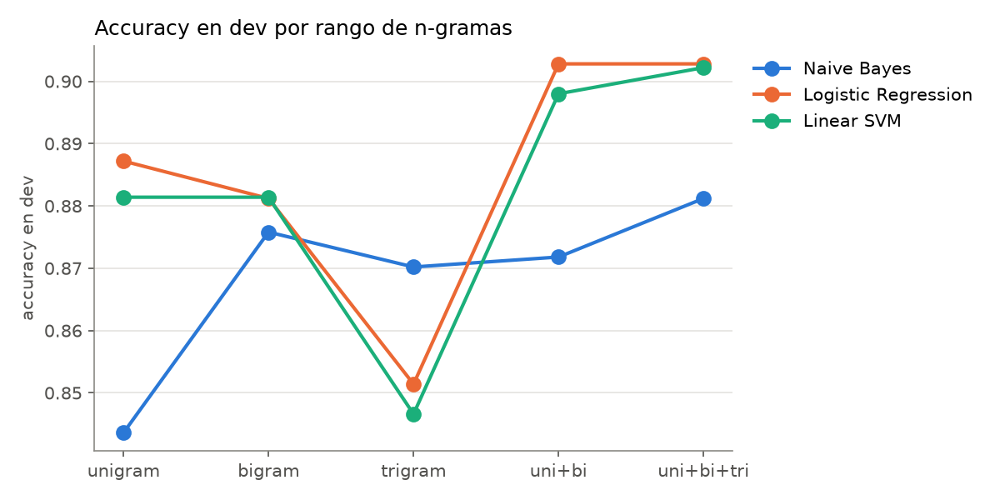
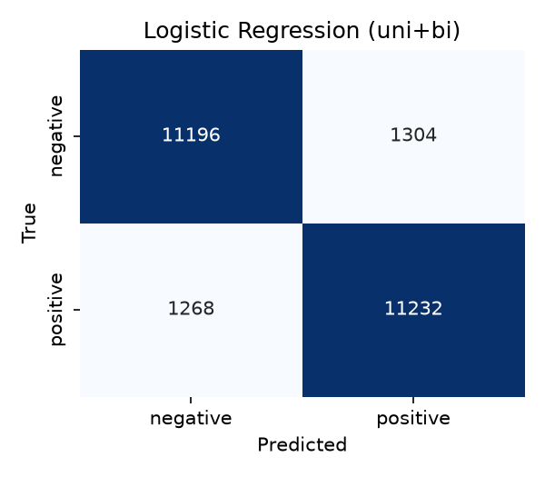

# 1. Método

**Datos.** Usamos el *Large Movie Review Dataset* de Maas et al. (2011): 50,000 reseñas de IMDb en inglés, divididas oficialmente en 25,000 de entrenamiento y 25,000 de prueba, cada mitad balanceada entre positivas y negativas. El servidor de Stanford no respondió durante el proyecto, así que el código descarga como respaldo la copia de Hugging Face (`stanfordnlp/imdb`), que tiene las mismas reseñas y etiquetas pero no la calificación de estrellas original; por esa razón el análisis opcional por intensidad de la polaridad quedó fuera y en su lugar analizamos el desempeño por longitud. Del conjunto de entrenamiento separamos un 20% como conjunto de desarrollo (estratificado, semilla 42) y dejamos las 25,000 de prueba intactas hasta la evaluación final.

**Preprocesamiento.** Cada reseña pasa por cinco pasos: se eliminan las etiquetas ` ` que IMDb deja en el texto, se convierte a minúsculas, se expanden las contracciones negativas (*didn't* a *did not*, *can't* a *can not*), se tokeniza con el `TreebankWordTokenizer` de NLTK y se quita la puntuación de los bordes de cada token. La decisión que creo más importante de todo el preprocesamiento es la de las *stopwords*: la lista estándar de scikit-learn incluye *not*, *no*, *never* y otras negaciones, y eliminarlas a ciegas impide que existan bigramas como *not good* o *not worth*, que son precisamente lo que un modelo de n-gramas puede aprender y uno de unigramas no. Por eso nuestra lista excluye las negaciones, y en el experimento principal decidimos no eliminar *stopwords* en absoluto, porque bigramas como *the worst* resultaron estar entre los rasgos más informativos (sección 2).

**Representación.** Cada reseña se convierte en un vector de conteos con `CountVectorizer`, comparando cinco rangos de n-gramas: solo unigramas, solo bigramas, solo trigramas, unigramas y bigramas, y unigramas a trigramas (`ngram_range=(1,3)`, la configuración que pide el enunciado). Usamos `min_df=2`, es decir, descartamos los n-gramas que aparecen en una sola reseña, porque con trigramas el vocabulario crece enormemente con frases que nunca se repiten y que no aportan nada a la clasificación.

**Modelos y protocolo.** Entrenamos tres clasificadores de scikit-learn: Naive Bayes multinomial ($\alpha = 1$), regresión logística y una SVM lineal ($C = 0.1$). Los quince pares de modelo y rango de n-gramas se evaluaron en el conjunto de desarrollo; para cada modelo elegimos el rango con mejor F1, lo reentrenamos con entrenamiento y desarrollo juntos y lo evaluamos una sola vez en prueba. Reportamos *accuracy*, precisión, *recall* y F1 tomando la clase positiva como referencia.

# 2. Resultados

| N-gramas | Rasgos | Naive Bayes | Regresión logística | SVM lineal |
|---|---:|---:|---:|---:|
| Unigramas | 44,124 | 0.844 | 0.887 | 0.881 |
| Bigramas | 316,127 | 0.876 | 0.881 | 0.881 |
| Trigramas | 384,387 | 0.870 | 0.851 | 0.847 |
| Uni + bi | 360,251 | 0.872 | **0.903** | 0.898 |
| Uni + bi + tri | 744,638 | **0.881** | **0.903** | **0.902** |

: *Accuracy* en el conjunto de desarrollo por rango de n-gramas.

La comparación en desarrollo deja tres patrones claros. El primero es que combinar órdenes de n-gramas mejora a cualquiera de ellos por separado: agregar bigramas a los unigramas sube alrededor de 1.6 puntos en regresión logística y en SVM, porque los bigramas capturan negaciones y modificadores (*not worth*, *the worst*, *well worth*) que una palabra aislada no puede representar. El segundo es que los trigramas solos son la peor opción para los modelos discriminativos (0.85), y creo que la razón es la escasez: aun con `min_df=2`, la gran mayoría de los trigramas aparece en muy pocas reseñas, de modo que el modelo tiene cientos de miles de rasgos y casi ninguna evidencia sobre cada uno. El tercero es que Naive Bayes es el modelo que más se beneficia de los n-gramas largos (de 0.844 a 0.881), lo cual tiene sentido si se piensa que su supuesto de independencia entre palabras es justo lo que los bigramas y trigramas compensan en parte.

{width=48%}

| Modelo | N-gramas | *Accuracy* | Precisión | *Recall* | F1 |
|---|---|---:|---:|---:|---:|
| SVM lineal | uni + bi + tri | **0.898** | 0.897 | 0.899 | **0.898** |
| Regresión logística | uni + bi | 0.897 | 0.896 | 0.899 | 0.897 |
| Naive Bayes | uni + bi + tri | 0.872 | 0.890 | 0.847 | 0.868 |

: Desempeño en el conjunto de prueba (25,000 reseñas) con la mejor configuración de cada modelo.

{width=26%} {width=26%} {width=26%}

En prueba, la SVM lineal y la regresión logística quedan prácticamente empatadas (una décima de diferencia, que no nos atreveríamos a defender como significativa), y Naive Bayes queda unos 2.6 puntos atrás. Las matrices de confusión muestran que los dos primeros se equivocan de forma simétrica entre clases, mientras que Naive Bayes tiene un *recall* bastante menor que su precisión: tiende a clasificar como negativas reseñas que en realidad son positivas.

Por longitud, el mejor modelo acierta 90.2% en reseñas de menos de 200 tokens y baja a 88.5% entre 400 y 799 tokens. La caída es pequeña, pero es consistente con lo que muestra el análisis de errores: una reseña larga tiene espacio para resumir la trama, comparar con otras películas y matizar, y en un vector de conteos el veredicto final pesa lo mismo que cualquier otra oración del texto.

Los rasgos con mayor peso en la SVM son en su mayoría los esperados (*worst*, *awful*, *waste*, *not worth* hacia lo negativo; *excellent*, *perfect*, *well worth* hacia lo positivo), pero entre los más fuertes aparecen también *7/10*, *4/10* y *a 7*. Hay quienes escriben su calificación dentro de la reseña, y el modelo aprendió a leer esa calificación en lugar del sentimiento del texto; no es un error como tal, pero sí un atajo que no se transferiría a un dominio donde nadie escribe "7/10".

# 3. Análisis de errores

La SVM se equivoca en 2,547 de las 25,000 reseñas de prueba (10.2%). Como primer filtro etiquetamos automáticamente cada reseña con pistas lingüísticas: presencia de negaciones, de conectores de contraste (*but*, *however*, *although*) y de comillas o frases asociadas al sarcasmo. El resultado fue poco informativo: el 88% de todas las reseñas contiene alguna negación, entre errores y aciertos por igual, así que la negación como tal no distingue nada. El contraste sí aparece algo más en los errores (84%) que en el total (80%), lo cual ya apunta a dónde está el problema, pero no lo explica. Por eso ordenamos los errores según la confianza del modelo y revisamos a mano los doce más seguros, que caen en cuatro grupos:

1. **Veredicto al final.** La reseña dedica la mayor parte del texto a criticar y cierra recomendando la película. La de *Brain of Blood* es el ejemplo más claro: "impossible to recommend to anyone looking for a good film but bad movie lovers should enjoy it. I liked it". Para un modelo sin noción de orden, gana lo que más se repite, y lo que más se repite es la crítica.
2. **Texto negativo con etiqueta positiva.** Reseñas que se leen negativas de principio a fin (*Comanche Moon*: "tedious, inconsistent and ultimately irrelevant"; otra que concluye "the content pretty horrible") pero cuya calificación fue de 7 estrellas o más. Creo que en estos casos el modelo tiene más razón que la etiqueta, ya sea por ruido en el dataset o por una calificación generosa que el texto no refleja, y ningún clasificador de texto podría acertar sin ver el número.
3. **Sentimiento dirigido a otro objeto.** La reseña expresa opiniones fuertes, pero no sobre la película: una elogia la carrera de Mickey Rourke y otras adaptaciones de Elmore Leonard, otra alaba las versiones de *Hamlet* de Olivier y Branagh, otra ama la serie *Happy Days* y critica que la edición en DVD cambió la música, y otra discute la prohibición de los cines en Arabia Saudita sin haber visto la película. Una bolsa de n-gramas sabe qué palabras aparecen, pero no a qué se refieren.
4. **Opiniones ajenas citadas para refutarlas.** La reseña de *Snakes on a Train* resume lo que otras críticas dicen de la película ("amateurish", "a hideous waste of time") para después defenderla. Es un caso parecido al sarcasmo: el texto literal contiene la polaridad contraria a la de quien escribe.

Lo que tienen en común los cuatro grupos es que el error no está en el vocabulario (el modelo sabe de sobra qué palabras son positivas y cuáles negativas) sino en la estructura del discurso: el orden en el que se presentan los argumentos, a quién se atribuye cada opinión y sobre qué objeto recae.

# 4. Conclusiones

Una representación de conteos de n-gramas con un clasificador lineal alcanza cerca de 90% de *accuracy* en IMDb, lo cual, para un método que ignora por completo el orden de las palabras más allá de una ventana de tres, es un resultado sólido. Los bigramas son la mejora que de verdad vale la pena; agregar trigramas casi no cambia nada y duplica el número de rasgos.

Conservar las negaciones durante el preprocesamiento no fue un detalle estético sino una condición para que los bigramas sirvieran, y creo que es la lección práctica más transferible del proyecto: los pasos de limpieza "estándar" pueden borrar justo la señal que el modelo necesita.

El techo del método está en los errores de mayor confianza, que no se deben a palabras desconocidas ni a negaciones aisladas, sino a reseñas cuyo significado depende de la estructura: el veredicto que llega al final, el sentimiento dirigido a otra película o a otra edición, la opinión ajena citada para contradecirla. Superarlo requiere modelos que representen el orden y la referencia (modelos de secuencia o con atención), y un subconjunto de los errores, el de las etiquetas que contradicen al texto, no lo resolvería ningún modelo, porque el problema está en los datos y no en el clasificador.
